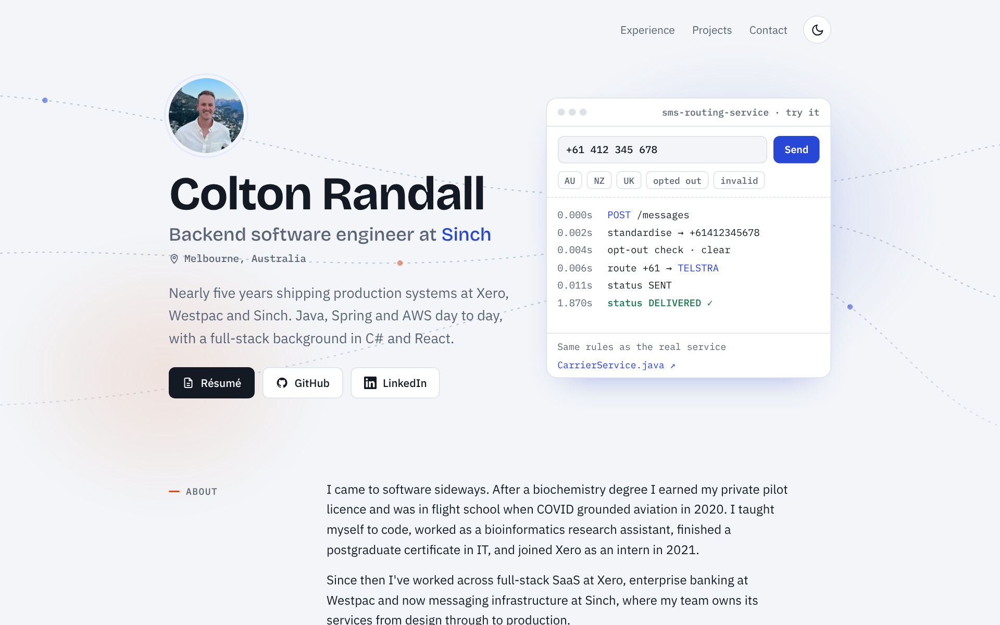
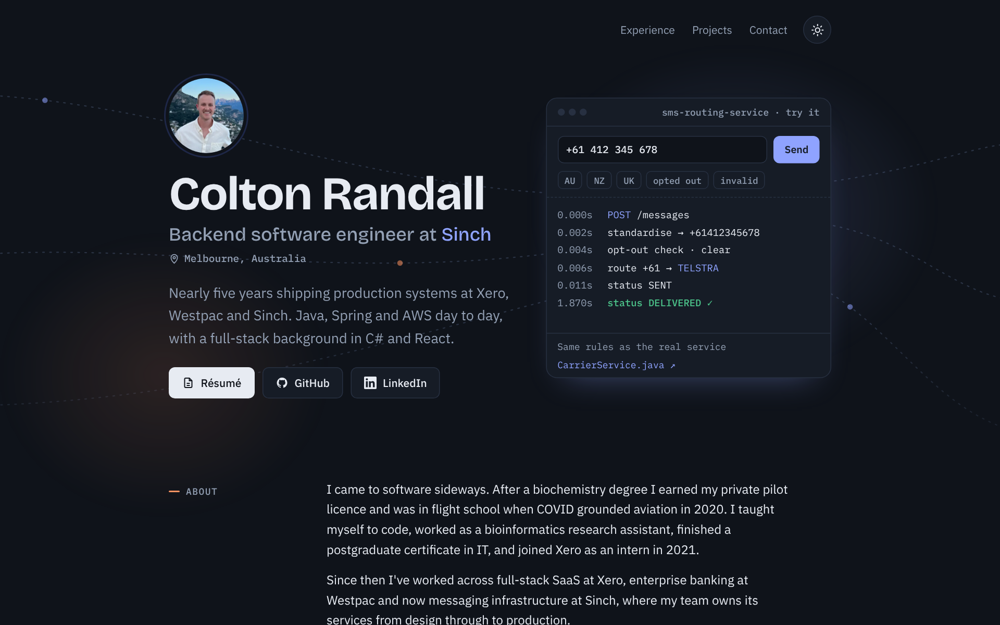

# coltonrandall.com

My personal site: [coltonrandall.com](https://coltonrandall.com)

A single static page built for recruiters and hiring managers. It covers my experience, selected projects and contact details, and includes a small working demo of my [SMS Routing Service](https://github.com/ColtonRandall/sms-routing-service) that applies the same carrier routing and opt-out rules as the real code.

 

## Stack

- Static HTML and CSS with a small amount of TypeScript, and no framework
- [Vite](https://vite.dev) for local dev and the production build, with `tsc` type-checking in strict mode
- Light and dark themes that follow the system setting, with a manual toggle
- Open Graph image, structured data and a sitemap so link previews and search results look right

## Run locally

```bash
npm install
npm run dev     # local site with hot reload
npm test        # unit tests for the demo's routing rules
npm run build   # type-check and production build
```

## Deploy

Merging to `main` deploys automatically: GitHub Actions runs the tests, builds the site and publishes it to GitHub Pages. Pull requests run the same checks without deploying.

To publish by hand instead, run `npm run deploy`.

## Files

| Path | What it is |
| --- | --- |
| `index.html` | Page content and structure |
| `src/styles.css` | All styles, including the light and dark themes |
| `src/sms-routing.ts` | Routing rules for the hero demo, mirroring the Java service |
| `src/sms-routing.test.ts` | Unit tests for those rules, matching the Java test cases |
| `src/main.ts` | Wires up the demo, theme toggle and copy-email button |
| `src/easter-egg.ts` | Something for the curious. Start with the plane on the timeline |
| `public/docs/` | The CV linked from the Résumé button |
| `public/images/og.png` | Link preview image for LinkedIn, Slack and similar |
| `public/404.html` | Sends old or broken links back to the home page |
| `.github/workflows/ci.yml` | Tests, build and automatic deploy |
| `infra/` | Terraform for the optional S3 deployment |
